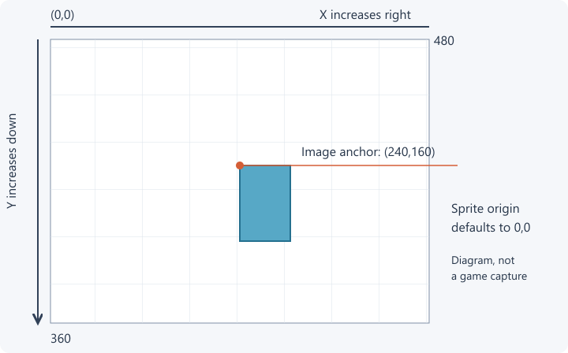

# Put your first image on screen

[Handbook](../README.md) / [Getting started](README.md)

This lesson puts one supplied image on screen 1. You need the [mods and working test map](README.md) first. The only MME concepts here are an image file, a position and the sprite that draws it.

## 1. Copy the lesson files

Open [lesson 1](../../examples/lessons/01-image/README.md). Copy its `mapping_settings.xml` and `mme-assets` folder into your editable map root, beside `level_settings.xml`.

```text
My MME Test/
  level_settings.xml
  mapping_settings.xml         <- the file you edit
  mme-assets/
    panel.png                  <- the image used by this lesson
  ...your existing native map files
```

If Windows hides file extensions, enable **View > Show > File name extensions** in Explorer and check that the file isn't named `mapping_settings.xml.txt`.

## 2. Read the small scene

Open `mapping_settings.xml` in a text editor. Its complete contents are:

```xml mapping_settings.xml
<MappingSettings version="1">
  <Assets>
    <Asset id="panelArt" path="mme-assets/panel.png" />
  </Assets>
  <Components>
    <Component id="panelPose" kind="transform">
      <Value name="position" value="240,160" />
      <Value name="screen" value="1" />
    </Component>
    <Component id="panel" kind="sprite">
      <Value name="transform" value="panelPose" />
      <Value name="asset" value="panelArt" />
    </Component>
  </Components>
</MappingSettings>
```

`panelArt` names `panel.png`. `panelPose` puts an object at X 240, Y 160 on screen 1. `panel` draws the image there. These names are your IDs: the sprite points to them through `asset` and `transform`.

The file path is relative to the map root. You can rename the IDs if every reference changes with them. Keep the spelling and case identical.

## 3. Build and launch

Follow [the loading steps for your editor](worldsmith.md). With Worldsmith Extension, open this map source, close Jump King and choose **Test in-game**. If you use ordinary Worldsmith, compile your level as usual, check the output contains the two added files, and open that compiled map in the game. Direct edits to a playable test copy need a map restart.

On **screen 1**, look for the panel near the middle of the screen. Its top-left corner is at `(240,160)`. It is decoration: you won't stand on it.


This image is rendered by MME on an empty test canvas. Your map's scenery and the King will also be present in the game.

## 4. Prove that an edit reaches the game

1. In `panelPose`, change `value="240,160"` to `value="180,100"`.
2. Save the XML.
3. Rebuild and launch again, or restart the map if you edited the playable copy directly.
4. The panel should move left by 60 pixels and up by 60 pixels.

If it stays in place, check which folder the editor built and which map the game opened. If it never appears, verify `mme-assets/panel.png` exists in that playable folder, enable MME, and follow [the missing-image checks](../reference/troubleshooting.md#my-image-doesnt-appear).

## Coordinates and anchors

A screen is 480 pixels wide and 360 pixels tall. `(0,0)` is the top left. X grows to the right; Y grows downward. Screen numbers start at 1. A sprite places the top-left corner of its image at the transform position unless you set `origin`.



The sensor, mesh and text anchors are explained in [placement](../scenes/placement.md); you don't need them to place this first sprite.

## Next

Continue with [lesson 2: move and enlarge an image](lessons.md#2-move-and-enlarge-an-image), then animation. Keep one lesson active at a time. [Combining examples](combining.md) shows how to keep several later.
