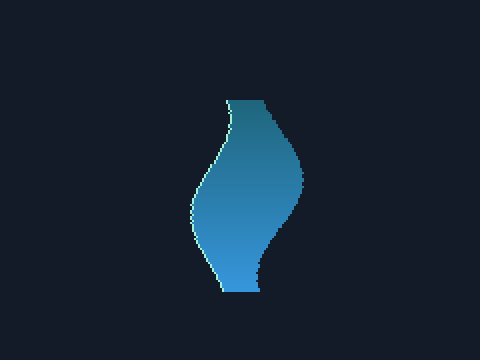
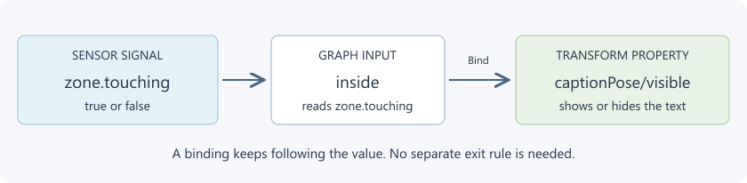
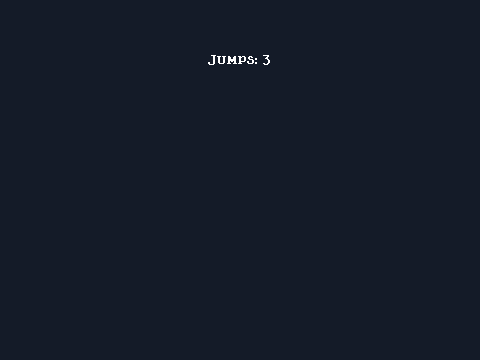

# Seven small MME lessons

[Handbook](../README.md) / [Getting started](README.md)

Use the same working test map throughout. Each [lesson folder](../../examples/lessons/README.md) contains a complete replacement `mapping_settings.xml` and exactly the extra assets it needs. Copy the next lesson over the previous entry, then [build and launch](worldsmith.md). Keep your native map files.

## 1. Put an image on screen

Follow [the first image lesson](first-scene.md). [Files](../../examples/lessons/01-image/README.md).

You should see a panel on screen 1. Change its position and verify the change reaches the game before continuing.

## 2. Move and enlarge an image

Copy [lesson 2](../../examples/lessons/02-placement/README.md). The panel now starts at `(180,100)`, uses `scale=2,2` and draws in `foreground`.

1. Launch the map and compare the panel's size with lesson 1.
2. Change the two scale values to `1,1` to restore the original size.
3. Set `screen` to `2` only if your map has a second screen. The image will appear there instead.
4. Restore screen 1 before continuing.

`scale=2,2` doubles width and height; it doesn't mean two pixels. Layer decides when the image is drawn. It doesn't change collision. See [placement](../scenes/placement.md) for anchors, parents and draw order.

The lesson images use MME's actual renderer on an empty test canvas. Your native scenery and the King appear too when you load the lesson in a map.

## 3. Play an animation

Copy [lesson 3](../../examples/lessons/03-animation/README.md). The supplied `digits.png` is a strip of ten cells, showing 0 through 9.

1. Launch and watch the small digit at `(240,180)` change.
2. Change the Asset's `fps` from `8` to `2`. Rebuild: the animation should slow down.
3. Change the sprite's `playback` from `pingpong` to `loop`. It should wrap from 9 to 0 instead of reversing.

`columns` divides the image into cells. `frames` is the number used. `fps` is frames per second. These are image settings; the sprite chooses playback. [Animation](../scenes/texture-animation.md) covers your own atlases and rolling counters.

[Initial frame](../images/lesson-03.png) / [later frame](../images/lesson-03-next.png): the sample digit is deliberately only 7 by 9 pixels.

## 4. Show a caption in an area

Copy [lesson 4](../../examples/lessons/04-area-caption/README.md). It needs no image files.

1. Launch on screen 1. You should see **You are on screen one.** near the top.
2. Change `zone/size` from `480,360` to `120,80` and rebuild.
3. Move the King into the center of the screen: X 180 to 300, Y 140 to 220. The caption appears while his body touches that box.
4. If the area is unreachable in your map, move `zonePose` to an accessible spot. Its position is the box's center.

The sensor is invisible. `zone.touching` is a true/false value. The graph reads it as `inside`, and the binding sends it to `captionPose/visible`. This is a continuous connection: leaving the area hides the caption without needing a second rule.

`phase=scene` is appropriate for this visible area check. [Contact sensors](../scenes/contact-feedback.md) explain when a surface or pre-teleport contact needs different timing.

## 5. Count jumps in this attempt

Copy [lesson 5](../../examples/lessons/05-jump-counter/README.md).

1. Launch: **Jumps: 0** should appear at `(240,60)`.
2. Make three jumps: the caption should read **Jumps: 3**. Starting to charge without jumping doesn't add one.
3. Start a new attempt: it returns to zero.
4. Change the Text constant's pattern to `My jumps: {0}` and rebuild.

`jumps` is an Integer variable. The `jump` event runs the rule once per native jump; `increment` adds one. The graph reads the variable, inserts it into the phrase with `template`, and binds the Text result to the caption. `scope=Attempt` gives each attempt its own count.

## 6. Play a sound on a jump

Copy [lesson 6](../../examples/lessons/06-jump-sound/README.md), including `mme-assets/chime.wav`.

1. Launch and jump. The counter advances and a quiet chime plays.
2. Set the `chime` component's `volume` to `0.1` and rebuild: it should become quieter.
3. Try your own short WAV by replacing `chime.wav`, keeping the path or updating `chime/path`.

`playAudio` targets an audio component ID, not a file path. One voice won't overlap itself, so very rapid jumps can occur while the previous short sample is still playing. Check the game's SFX/master volume if it is silent. [Audio](../game/audio.md) explains loops, fades and sound zones.

[Rendered counter after three jumps](../images/lesson-06.png). The audio action is checked separately; an image cannot demonstrate audible playback.

## 7. Keep a counter between attempts

Copy [lesson 7](../../examples/lessons/07-saved-counter/README.md). Use your learning map and its own native save.

1. Jump several times, then start another attempt in the same native save context without choosing the game's save reset/New Game operation.
2. The count should survive the attempt change. `scope=Save` is the changed variable setting.
3. Leave and reopen the same map through a normal saved session to check your map's save path too.
4. A native save reset clears the stored total. For a real map, choose your own stable `saveId` instead of `mme-lessons`.

The scene's `saveId` identifies its saved variables inside the native save context. Keep it stable while editing art or renaming the map. [Saves](../scenes/state.md) explains restarts, reset and practice snapshots.

[Rendered saved counter](../images/lesson-07.png). The lesson check also writes/loads an isolated save and verifies reset behavior.

## Continue with your own idea

[Combine two examples](combining.md), then use [the task catalogue](examples.md). For reactions, learn [rules and effects](../scenes/behaviors.md) before waiting/branching [trees](../scenes/behavior-trees.md). You can return to exact field tables when you need another setting.
