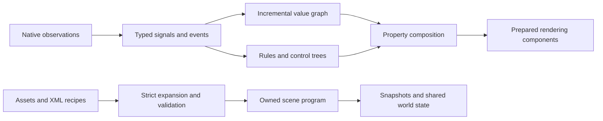

# Construction architecture

[Handbook](../README.md) / [Reference and diagnostics](README.md)

This page is for engine and integration developers. Map authors can follow [the task guides](../README.md) and [field explanations](components.md) without learning these internals.

MME separates authoring from observations, evaluation, state and rendering. A planet, gaze, stream, clock or impact response is a recipe assembled from the same parts. None is a special runtime entity.

## Boundaries

The api directory contains detached immutable values, observation metadata, public capabilities and effect leases. src/Construction owns descriptors, signals, composition, rules and control flow. src/Authoring owns DTOs, recipes, cache and layout parsing. src/Simulation owns graphs, fields, sensors, transforms and geometry math. src/State owns snapshots/shared packets. src/Rendering owns prepared resources and drawing. src/Native owns gameplay/cutscene observations, captures, hooks and collision adapters. src/Runtime owns activation/persistence and API gateways. src/Endings adapts native trees; src/Diagnostics owns the descriptor-driven inspector.

ComponentModel and PrimitiveRegistry declare field types, defaults, units, bounds, references, resource impact, lifetime and draw factory. The compiler, inspector and generated reference use these descriptors. Structural fields are fixed after preparation. Draw factories prepare component commands; frame rendering doesn't dispatch on scene concepts.

## Preparation and ownership

OnWorldReady owns movement contracts, native interaction bridges, rendering hooks and a content-addressed asset pool. BeforeAttempt reads current XML, reuses or refreshes the local expanded-scene cache, and prepares resources and native endings without a player. Normal activation attaches observations, snapshot/world participants, compositor and capability publication.

The optional physics-frame adapter prepares its coordinate state at WorldReady
and binds a body at activation. Its small native hook set is installed dormant
at BeforeLevelLoad: `BodyComp.GetHitbox` can otherwise be inlined into methods
JIT-compiled before a later map enables the adapter. World teardown drops the
owner and all body state; the dormant hooks then return native results. They do
not tick or retain a player. [Physics frames](../maps/physics-frames.md) describes
the opt-in configuration and limits.

The disk cache is owned by MME under local application data, not by the map or its build tool. It holds expanded definitions only. Its key identifies the map directory; its header checks merged source and the embedded implementation identity. Reads validate size and payload hash. Writes replace the previous entry atomically, and cache I/O failures fall back to XML. Source errors still fail preparation. No cached player state or prepared resource survives through this file. See [cache lifecycle and limits](../getting-started/files.md#automatic-local-cache).

World, attempt, activation and effect resources have scopes. Candidate failures dispose candidate resources. Reload detaches the old activation only after candidate validation; failed activation restores the previous scene. Successful replacement releases previous resources. No private player startup hook is needed.

Textures, alpha channels, meshes, atlas buffers, particle pools, capture targets and effects are prepared owned resources. The world asset pool reuses unchanged content across attempts and evicts inactive old entries within its budget. Files are fingerprinted before reuse. Contracts expose no native entities, GPU handles or mutable DTOs.

Attempt preparation also draws each populated scene screen into a temporary
offscreen target. This primes the owned rendering paths before player handoff,
without advancing clocks, dispatching rules or capturing native actors. It restores
the caller's target and graphics state afterward. Startup traces report this work
as `mega-mapping.graphics-prime`; it adds loading work rather than hiding it in
the first playable frames. Capture-dependent outputs still wait for their live
sources. The renderer owns its white texture; it doesn't borrow the native Pixel
before IntroState creates it. Text using native font presets waits for normal
drawing rather than asking the game to initialize that font early.

## Frame semantics

Native observations publish as a coherent batch. Contacts use completed movement-resolver evidence before return-block behavior consumes it. Scene-phase sensors sample current actor pose. Jump events retain corrected launch F; charge-time estimates are marked accordingly.

The scene advances clocks, evaluates the graph, dispatches events/trees when gameplay advances or an active ending permits Presentation logic, ticks fields, refreshes variable-dependent branches, updates effects and commits properties. Pure graph branches skip unchanged inputs. Stateful nodes use their selected clock; zero-time refresh doesn't integrate again. Only explicit delay breaks graph cycles. Property inputs observe the last committed value; use graph nodes for direct dependencies and explicit delay for intentional feedback.

Composition starts from authored baseline and applies bindings and owned contributions in stable priority/ID order. It publishes changes after all slots commit. Removing an owner recomputes from current remaining inputs. Failed listeners, graph branches, rules and sensors report diagnostics without stopping independent branches. Queues and recursion are bounded.

Native pause/completion hold gameplay. Presentation continues through completion, but pause/UI hold it unless the selected view explicitly enables animateWhilePaused. Active endings keep event dispatch and presentation-clock trees running while gameplay stays stopped. The presentation toggle holds both clocks/rules while collision/routes remain installed. Following worlds consume authoritative state instead of running local logic or writing personal saves.

## State

| State | Lifetime and restore |
|---|---|
| Component baseline | Immutable compiled scene |
| Graph memories, fields, sensor memberships, variables, rules, trees, effects | Attempt state, snapshots and shared packets |
| Save variables | Attempt state plus native save-context persistence |
| Physics-frame fractional Y | Player attempt state, Runtime snapshots and shared packets |
| Continuous particles and automatic atlas playback | Reconstructed from scene clocks and prepared definitions |
| Bursts and stamps | Transient; clear on restore, no historical sound replay |
| Inspector previews | Local contributions; excluded from portable world state |
| GPU textures and geometry | Prepared resources, never serialized as game state |

Shared packets validate scene/compiler identity, decoded assets, types, counts, finite values and size limits before mutation. Restore publishes a coherent batch and doesn't rerun actions. Generation changes invalidate old effect leases. Reload requires rebinding to the new signal hub. Followers cannot activate effects, emit events or write variables through the API.

Save variables live under MegaMapping/Construction/<saveId hash>.xml in the native save context. Reset invalidates old owners so an earlier attempt can't resurrect saved values. Receiving world state doesn't write personal saves.

## Native adapters

`NativeControllers` consumes committed properties after scene evaluation. Its partial files separate audio, NPCs, victory predicates and camera requests. Descriptors and validation live in `Construction/NativeDescriptors`; native lookup and hooks stay in `Native`. An adapter bridges an existing game system. It does not own a second NPC conversation database, inventory save or ending manager.

Audio voices prepare through Runtime's `PreparedSound`, including compiled XNB content. The world sound pool fingerprints encoded content and leases separate voices to overlapping reload candidates. Activation binds pause ownership; teardown stops voices. Native NPC overrides restore their original line pause. Native wall adapters validate selectors against the loaded map and establish contact baselines without synthesizing entry events.

Runtime owns `CameraShots` arbitration and `NativeScreenView` draw scopes. Smooth Camera provides interpolation and composition. MME submits scoped requests; it never writes the gameplay screen or body position to show another room. Exclusive replay targets take precedence. The shared draw hooks have one owner regardless of which mod prepares them first.

Text reveal is a property and observation, not a dialogue interpreter. Its layout uses the full string while drawing only the visible prefix. Rules, graphs and trees supply timing and sound policy. New movement observations likewise describe native actions and measured motion rather than introducing one component per decorative use.

## Extend the constructor

Add a general descriptor/backend only when existing parts can't express the behavior. Declare type, units, bounds, impact, lifetime and preparation requirements together. Keep native evidence in adapters, reusable math in the core and scene meaning in recipes. Add focused state/behavior tests, regenerate the catalog and provide a working example. Rendering batches compatible quads, reuses unchanged mesh vertices and prepares field/deformation property slots before sampling. New art usually needs a recipe and assets. Geometry remains useful for masks, projections, previews and procedural art.

## Practical reading

Read [state and ownership](../scenes/state.md) for author-facing save/restore rules and [capabilities and budgets](features.md) before scaling a scene. The [handbook](../README.md) links every feature family to worked examples. Rendering and Simulation remain separate: simulation produces typed state and geometry math; rendering owns prepared GPU resources and draw commands. Neither folder contains a special planet or gaze entity.

Native intro adapters read the prepared attempt before the player is attached.
Result adapters own their hooks at world scope and retain detached row snapshots
after attempt disposal. Capturing a result refreshes pure graph values and
composed properties without ticking clocks or dispatching events. A new attempt
clears the old results session; world disposal releases hooks and snapshots.
NPC adapters borrow sprite and position state only while drawing, with finalizers
to restore it. A conversation freezes its chosen quote at native FetchQuote.
